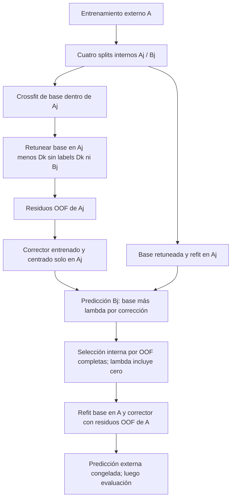

# F8 — Cross-fitting anidado de todas las etapas

Estado: diseño propuesto, no implementado como estimador ni ejecutado.

Sea E la validación externa y A su entrenamiento. Se conservan65 particiones externas y las cuatro internas archivadas de A. Definir TuneBase(S,CV_S) como el algoritmo C-T3 completo: imputación/escala/constantes por fit, selección entre12 combinaciones EN exclusivamente mediante CV_S, luego refit sobre S. Para lluvia3 opcional cambiar solo columnas, no reutilizar falsamente el control4.

1. **Targets para el entrenamiento A:** para cada split original (A_j,B_j), ajustar TuneBase(A_j,CV_deeper(A_j)), donde CV_deeper usa únicamente A_j y restricciones del protocolo. Predecir B_j y llenar p_CF(A). Cada etiqueta de B_j queda fuera del ajuste, transformación Y/X y selección de HP de su propia predicción. Construir r_CF(A)=y_A-p_CF(A). No parámetros globales seleccionados con A reutilizados en esas predicciones.
2. **Evaluación interna de correctores:** para evaluar θ,λ sobre B_j NO subdividir simplemente r_CF(A). Reconstruir r_CF(A_j) desde cero: partir A_j en folds geográficos/aleatorios locales, y para cada heldout D_k ajustar TuneBase(A_j\D_k, CV_deeper(A_j\D_k)). Así ni B_j ni D_k influyen en HP o transforms de esa base. También ajustar TuneBase(A_j,CV_deeper(A_j)) para predecir B_j.
3. Ajustar corrector θ y sus imputaciones/escalas únicamente en X_Aj,r_CF(A_j). Ridge sobre predictor centrado, sin intercepto. CatBoost sobre r_CF y definir g=h-mean_Aj(h(X_Aj)); centrar predicciones del corrector usa solo filas de entrenamiento, no cambia r_CF por residuos in-sample. Coeficientes y g pueden ser positivos/negativos.
4. Predecir B_j como base_Aj(B_j)+λg_Aj(B_j). Acumular las predicciones de los cuatro B_j y calcular RMSE/MAE/sesgo sobre OOF interna completa. Elegir θ y λ entre propuestas acotadas; λ=0 siempre disponible. Estas etiquetas internas sirven para selección, jamás para generar sus propios targets o transformaciones. No early stopping externo; preferir número fijo de árboles candidato.
5. Repetir todo para cada representación autorizada (R1/R2/C-V, y R3 solo tras revisión), compartiendo caches de base por IDs/CV/columnas/grid/implementación/seed, no por nombre genérico de fold. La selección absoluta prima sobre diferencias intraperfil; no repetir el objetivo local-first de B.
6. Con θ*,λ*, ajustar corrector sobre A,r_CF(A), centrarlo respecto de A y reajustar TuneBase(A,inner_original_A) sobre A. Predecir E: base_A(E)+λ*g_A(E). No mirar y_E hasta congelar predicciones. Si λ*=0, omitir ajuste corrector final y retornar exactamente la base.
7. Las predicciones R0 externas deben coincidir con C-T3 archivado. Puede reutilizarse el modelo externo de C-T3 si todas las columnas, preprocess, grid, IDs y CV coinciden. **Las predicciones internas R0 deben retunear la base sobre cada A_j**: el mejor HP de todo A vio y_Bj, por lo que no sirve como anchor interno honesto del algoritmo completo. No exigir que esas OOF internas coincidan con la configuración globalmente elegida en A.
8. Guardar ledger por fit/selector: IDs de ajuste, selección, residual-heldout e inner/outer validación, hashes y roles; arrays p_CF,r_CF; parámetros, λ, base/corrección/predicción externa, tiempos y warnings. Probar que modificar y_E o y_Bj no cambia ningún target/transform/modelo que lo predice; λ0 reproduce base; corrector constante se desactiva; reconstrucción anidada exacta y signos/centrado correctos.



## Desacoplamiento crossfit/refit

Los residuos r_CF=y-m_minusfold contienen error de una base entrenada en menos datos; al inferir usamos m_full. Su diferencia es r_CF-r_full=m_full-m_minusfold. El corrector puede aprender parte del error de estimación de la base pequeña en lugar de desviación parcelaria transferible. Cross-fitting elimina autorreferencia de targets pero no elimina esta discrepancia.

Diagnosticar dentro de cada entrenamiento la distribución de Δ=m_full(X_train)-p_CF, medias por perfiles disponibles, correlaciones con g y amplitud aplicada; r_full solo es un diagnóstico, jamás sustituto supervisado. Las validaciones internas reproducen la misma discrepancia de tamaño, aunque escala no idéntica al outer refit. Centrado TRAIN y λ discreto acotado reducen drift global, sin garantizar calibración territorial. Una base promedio de modelos de crossfit sería otra arquitectura y control distinto: no sustituirla retrospectivamente a C-T3 para ocultar mismatch. No calibrar discrepancia con labels externos.

Si un nivel requiere menos de2 grupos, marcarlo no evaluable y detener esa variante; nunca cambiar a CV aleatoria. Los casos de todas las entradas constantes requieren fallback explícito a media TRAIN para base o g=0 para corrector, sin usar y heldout. Registrar min tamaños y pérdida de soporte. La simulación de particiones verifica pertenencia, no ajusta ni certifica rendimiento de modelos futuros.

Fuentes primarias: [nested CV](https://scikit-learn.org/1.7/auto_examples/model_selection/plot_nested_cross_validation_iris.html), [predicciones cruzadas vs prefit](https://scikit-learn.org/1.7/modules/generated/sklearn.ensemble.StackingRegressor.html). El procedimiento F8 añade retuning de base a cada profundidad; no se afirma que un StackingRegressor por sí solo implemente este residual anidado.


Presupuesto simulado, sin ajustes:

```json
{
  "unique_base_tuning_contexts": 1218,
  "base_EN_fits_upper_without_existing_cache": 59094,
  "R1_corrector_fits": 845,
  "R2_corrector_fits": 1625,
  "C_V_corrector_fits": 1625,
  "lambda_adds_no_model_fits": true,
  "actual_new_fits": 0,
  "existing_context_reuse": "only identical dataset, features, preprocessing, CV, grid, seed and exclusion provenance; cached outer C-T3 reusable, not globally chosen parameters in inner evaluation"
}
```

| protocol | level | n_contexts | n_train_min | n_train_median | n_train_max | n_groups_min | n_all_rain_constant | n_all_compact4_constant |
| --- | --- | --- | --- | --- | --- | --- | --- | --- |
| climate_profile | base_outer_selection | 20 | 75 | 84.000000 | 88 | 15 | 0 | 0 |
| climate_profile | deep_base_tuning_excludes_residual_heldout | 320 | 25 | 46.500000 | 74 | 3 | 0 | 0 |
| climate_profile | inner_base_selection_and_residual_crossfit | 80 | 50 | 62.000000 | 76 | 5 | 0 | 0 |
| municipality | base_outer_selection | 20 | 37 | 94.500000 | 117 | 3 | 0 | 0 |
| municipality | deep_base_tuning_excludes_residual_heldout | 270 | 10 | 31.000000 | 104 | 1 | 0 | 0 |
| municipality | inner_base_selection_and_residual_crossfit | 78 | 21 | 51.000000 | 111 | 2 | 0 | 0 |
| random | base_outer_selection | 200 | 82 | 83.000000 | 84 | 82 | 0 | 0 |
| random | deep_base_tuning_excludes_residual_heldout | 3200 | 45 | 47.000000 | 48 | 45 | 0 | 0 |
| random | inner_base_selection_and_residual_crossfit | 800 | 61 | 62.000000 | 63 | 61 | 0 | 0 |
| spatial | base_outer_selection | 20 | 63 | 84.000000 | 110 | 3 | 0 | 0 |
| spatial | deep_base_tuning_excludes_residual_heldout | 120 | 10 | 35.000000 | 38 | 1 | 0 | 0 |
| spatial | inner_base_selection_and_residual_crossfit | 60 | 28 | 54.000000 | 75 | 2 | 0 | 0 |

Verificación: cinco pruebas pasaron; cero ajustes/predicciones nuevos; 158 fuentes consumidas verificadas. Se conserva inventario de15382 hashes anteriores; los archivos no utilizados no se reabrieron para rehash. Escrituras limitadas a nueva versión F8 y sus documentos.
