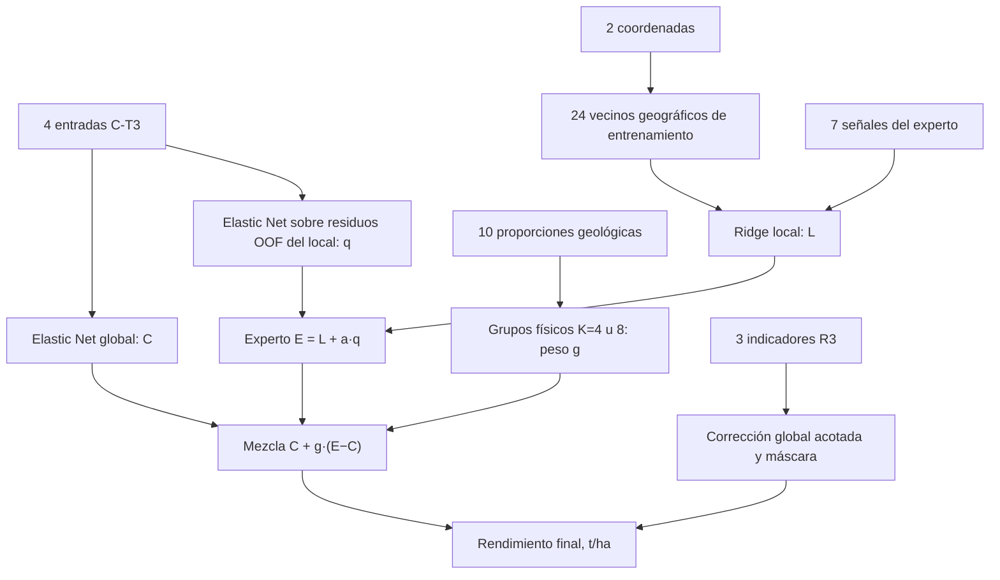

# Reference26 — ficha del modelo

Estado vigente: 2026-10-18. Champions actuales: **Reference26 y Compact14**. [Índice de modelos](../README.md).

## Función y arquitectura

**Champion actual de precisión y equilibrio territorial.** Alias: FULL7_ON_RAW_MASK y, en su etapa previa, SHARES_MASK.

`predicción = C-T3 + g(geología)·(experto7 − C-T3) + intensidad·soporte_R3·delta_R3`.

El experto utiliza siete señales no climáticas, estandarizadas en entrenamiento, en Ridge local de 24 vecinos geográficos, alpha30 y potencia de distancia1. Incluye una corrección Elastic Net interna sobre residuos propios con las cuatro entradas C-T3. Las dos coordenadas eligen vecinos; las diez proporciones geológicas gobiernan una mezcla convexa entre expertos mediante agrupaciones físicas y pesos regularizados. No son diez correcciones aditivas independientes ni un vecino elegido por similitud satelital.

R3 emplea tres indicadores en Elastic Net (alpha .01, l1_ratio .5); su salida se limita a ±.5 y multiplica por .5. La intensidad 0/.5/1 se selecciona internamente. La corrección máxima resultante es ±.25 t/ha y se desactiva para la parcela si falta cualquiera de sus tres indicadores. Imputación, escalado y calibración se ajustan dentro del entrenamiento correspondiente.

## Recorrido de una predicción

Para una parcela, el sistema calcula dos estimaciones: **C**, de C-T3, y **E**, del experto local con corrección interna. La geología determina cuánto confiar en cada una. Al resultado se añade un ajuste residual acotado, R3:

`Reference26(x) = C(x) + g(x)·[E(x) − C(x)] + s·m(x)·δR3(x)`.

Aquí `g(x)` es el peso del experto entre 0 y 1, `s` la intensidad R3 elegida internamente y `m(x)` vale 1 sólo cuando están disponibles sus tres indicadores. Son **26 entradas distintas = 4 base + 7 experto + 2 coordenadas + 10 geología + 3 R3**. Las cuatro entradas base se reutilizan en el corrector interno del experto, sin contarlas otra vez.

### 1. Base C-T3: de dónde vienen sus cuatro entradas

El nombre **C-T3 procede de la Etapa C**, que contrastó representaciones de transferencia: C-T0 empleaba siete lluvias mensuales y NDVI; C-T2 añadía DTR; **C-T3 sustituyó las siete lluvias por tres resúmenes deterministas y conservó NDVI de mayo**. C-T4 añadió DTR al compacto. C-T3 destacó como representación compacta para transferencia municipal, con compromisos en otros protocolos; no surgió como ganador universal ni como selección de cuatro columnas por un p-valor.

Procedencia: [diseño y resultados de Etapa C](../../territorial_program_stage_c.md), [decisión de Etapa C](../../territorial_program_stage_c_decision.md) y [función original compact_features](../../../src/family_4/stage_c_models.py). Explicación independiente: [README de C-T3](../CT3/README.md). Después, F5/F6/F7 reutilizaron estas mismas cuatro entradas para contrastar arquitecturas.

Sea `P_m` la precipitación mensual de abril a octubre de 2025, `T = suma(P_m)` y `ε = 10⁻⁶ mm`, fijo antes de modelar:

| Entrada | Cálculo y unidad | Qué permite representar | Qué no conserva |
|---|---|---|---|
| `compact_precip_total` | `T = P_abril + … + P_octubre`, en mm | Intensidad acumulada de lluvia del ciclo | No distingue en qué mes llovió |
| `compact_early_fraction` | `(P_abril + P_mayo + P_junio)/(T+ε)`, sin unidades | Cuánta lluvia se concentra al inicio respecto al total | No distingue abril, mayo y junio entre sí, ni ordena los cuatro meses restantes |
| `compact_concentration_hhi` | `suma_m [(P_m/(T+ε))²]`, sin unidades | Lluvia repartida entre meses frente a lluvia concentrada en pocos meses | No identifica cuáles fueron los meses de concentración |
| `S2_ndvi_month_05` | Media de las observaciones disponibles de `ndvi_promedio` Sentinel-2 de mayo de 2025 por parcela; sin unidades | Estado relativo de la vegetación en mayo, la señal satelital del núcleo | No mide directamente rendimiento ni una fecha de siembra observada |

Como referencia para HHI, con lluvia positiva igual en los siete meses resulta aproximadamente `1/7`; si prácticamente todo cae en uno, se aproxima a 1. Con todas las lluvias cero, los tres resúmenes son cero. Si falta un mes, la construcción conserva el faltante y la imputación ocurre dentro del entrenamiento. No se rellena una lluvia desconocida como cero.

Las tres variables de lluvia son iguales para parcelas con el mismo vector climático. NDVI puede aportar variación por parcela; si coinciden las cuatro entradas, C-T3 produce la misma predicción. NDVI no convierte el núcleo en un modelo exclusivamente climático. Las ventanas hasta octubre hacen de éste un modelo retrospectivo del ciclo, no un pronóstico disponible en mayo.

C-T3 es un **Elastic Net global**, con intercepto, imputación y escalado de entrenamiento. Su rejilla interna conserva `alpha ∈ {.001,.01,.1,1}` y `l1_ratio ∈ {.1,.5,.9}`. Sus coeficientes son los de ese ajuste y no pesos físicos universales. [Implementación de las cuatro entradas y el modelo](../../../src/ct3_residual_conditional/models.py); [construcción mensual satelital](../../../src/family_1/m_satellite.py).

### 2. Experto: las siete señales y cómo se usan juntas

Estas variables proceden de la ingeniería de señales de GeoC, auditada y copiada al flujo local de fira_nuria. La investigación de [reparto de señales](../../signal_role_allocation_results.md) separó clima y experto complementario; la [simplificación conjunta J7](../../joint_simplification_results.md) conservó estas siete, retirando del experto las dos estadísticas históricas de MSI y tres entradas SoilGrids de sus variantes anteriores. Posteriormente se ajustaron la compuerta y R3 para llegar a Reference26.

Las siete se introducen **juntas como columnas originales estandarizadas en un Ridge local**. No son siete componentes PCA ni siete variables con significancia individual demostrada. Su inclusión se sustenta en las comparaciones de bloques y ablaciones; no permite atribuirles un efecto causal o afirmar que un coeficiente tenga el mismo signo en todas las parcelas.

| Variable exacta | Construcción / soporte temporal | Información que ofrece al experto |
|---|---|---|
| `sat_basic_hist__sentinel_2__ndvi_promedio__mean` | Media de `ndvi_promedio` entre capturas históricas Sentinel-2 de abril–octubre, 2022–2024 | Nivel habitual de vegetación de la parcela antes del ciclo objetivo |
| `sat_basic_hist__sentinel_2__ndvi_promedio__std` | Desviación estándar temporal de esos valores de `ndvi_promedio`, agrupados sobre el período histórico | Variabilidad de la señal histórica; no es desviación de rendimientos ni una dispersión de píxeles calculada aquí |
| `emp_shape__y2025_planet_evi__turning_fraction` | Serie mensual EVI Planet abril–octubre de 2025: calcular pendientes entre puntos válidos, retirar signos cero y dividir cambios de signo entre el número de pares de signos consecutivos | Forma irregular o cambios de dirección de la trayectoria de vegetación; no identifica por sí sola estrés ni etapas fenológicas |
| `agro_pheno__y2025_planet_ndvi__jun_to_aug_delta` | `NDVI_agosto − NDVI_junio`, resúmenes mensuales Planet 2025 | Diferencia entre dos momentos del ciclo: aumento, estabilidad o descenso de la vegetación |
| `sat_basic_2025__sentinel_2__ndwi_promedio__mean` | Media de `ndwi_promedio` entre capturas Sentinel-2 de abril–octubre de 2025 | Nivel de la señal espectral NDWI durante el ciclo; puede aportar contexto relacionado con agua y vegetación, sin demostrar humedad del suelo o anegamiento |
| `sat_basic_2025__sentinel_2__ndwi_promedio__std` | Desviación estándar temporal de esos valores de `ndwi_promedio` en el ciclo 2025 | Variación temporal que el promedio oculta; no es una medida nueva de variabilidad espacial dentro de la parcela |
| `topo_official__slope__mean` | Media zonal de la pendiente en grados del ráster `Pendiente_INEGI_CEM4_120m_grados.tif` | Contexto de relieve. Es una fuente de 120 m, cuya media parcelaria no implica resolver detalles de relieve a menor escala |

Las medias/desviaciones heredadas agrupan observaciones disponibles; no son automáticamente una media de tres medias anuales con igual peso a cada año. La configuración original fija abril–octubre y 2022–2024 para historia. El catálogo conserva las definiciones y advertencias del origen: [inventario de señales GeoC](../../geoc_variable_signal_audit.md), [catálogo C4 con fórmulas cuando están documentadas](../L40/variables_C4_2082.csv) y [procedencia de sus manifiestos](../L40/inventory_provenance.json). Reference26 requiere estas siete columnas, no la PCA ni las 2,082 entradas de L40.

### 3. Vecinos: cuántos, cómo y en qué punto intervienen

Para predecir una parcela `x`, el experto local realiza estos pasos:

1. Usa latitud y longitud de centroides para consultar las distancias geográficas congeladas, basadas en distancia de gran círculo. Ordena **sólo las parcelas del entrenamiento correspondiente** por cercanía.
2. Toma las **24 más cercanas**. En validación externa nunca usa la etiqueta de una parcela retenida; en el ajuste final, las candidatas son las 138 conocidas, y las 59 desconocidas no aportan etiquetas ni pasan a ser vecinos etiquetados unas de otras. No hay restricción de pertenecer al mismo municipio, estado o perfil climático.
3. Imputa por medianas y estandariza las siete columnas con el entrenamiento correspondiente. Esa representación se ajusta antes de consultar la parcela y se conserva para la consulta; no se calcula usando su rendimiento.
4. Ajusta un Ridge específico para la consulta con las siete señales y los rendimientos de esos vecinos. Los cercanos pesan más: `w_i = 1/(d_i + 10⁻⁶)`, donde `d_i` es la distancia normalizada congelada. Se conserva la escala histórica —mediana de vecino más cercano de aproximadamente 0.399745483 km— porque cambiarla alteraría la regularización efectiva.
5. Minimiza `suma_i w_i·(y_i − b − z_i·β)² + 30·suma_j β_j²`, con intercepto sin penalizar, y evalúa la regresión en las siete señales de `x`. Así obtiene **L(x)**.

En consecuencia, **cada consulta puede tener vecinos y coeficientes locales distintos**. No es simplemente el promedio del rendimiento de los 24 ni una única regresión global de siete coeficientes. Las siete señales son predictores del Ridge; las coordenadas son las que eligen sus vecinos. Si hubiera menos de 24 candidatas disponibles se usan las disponibles; con menos de tres, la implementación recurre a la media de entrenamiento.

La receta mantiene `k=24`, `alpha=30` y potencia de distancia 1, heredados de la línea local de L40 y preservados para estudiar composición de señales. No se afirma que 24 sea un óptimo universal ni se lo reoptimiza mirando las59. [Resolución exacta del Ridge local](../../../src/local_ridge_sufficient_statistics.py), [representación de señales](../../../src/geoc_signal_research.py).

**Corrección interna del experto.** Tras construir el local, una Elastic Net aprende a predecir sus residuos honestos `y − predicción_local_OOF` usando las **mismas cuatro entradas C-T3**, con coeficientes propios. Se obtiene `E(x) = L(x) + a·q(x)`, donde `a ∈ {0,.25,.5}` y los parámetros Elastic Net se seleccionan dentro del entrenamiento. Es una regresión residual global del experto: no se ajusta un segundo corrector exclusivo con los 24 vecinos de cada consulta. [Código de ajuste y residuos internos](../../../src/signal_role_allocation.py).

### 4. La geología decide el peso, no los 24 vecinos

Las diez proporciones cartográficas enumeradas más abajo describen la composición geológica de la parcela. Se transforman mediante raíz cuadrada y centrado usando entrenamiento; se conservan ceros y no se divide por la rareza de cada clase. Esta representación física, sin PCA en Reference26, alimenta una agrupación **KMeans de 4 u 8 grupos**, cuyo tamaño se elige internamente.

Con predicciones OOF de C-T3 y del experto se aprende un peso convexo para cada grupo, regularizado hacia un peso global. El término de contracción usa `20·media[(E_OOF−C_OOF)²]`: ese **20 es regularización, no veinte vecinos**. Para una consulta se asigna su grupo geológico y se aplica el peso `g(x)` aprendido allí.

Un peso cercano a cero aproxima la mezcla a C-T3; uno cercano a uno la aproxima al experto. Los grupos no son municipios ni etiquetas manuales de rendimiento. La geología puede estar asociada a regiones, pero eso no prueba transferencia territorial. [Transformación física](../../../src/physical_representation.py), [compuerta y pesos](../../../src/conditional_local_phases.py), [selección de la compuerta geológica](../../../src/base_distribution_correction.py).

| Parte del modelo | ¿Usa vecinos para esta operación? | Tamaño / ámbito |
|---|---|---|
| C-T3 | No | Elastic Net global en el entrenamiento |
| Ridge local de siete señales | **Sí: geográficos** | 24 vecinos por consulta, o los disponibles |
| Elastic Net interno del experto | No | Residuos OOF del local en el entrenamiento |
| Compuerta geológica | Agrupa por composición, sin k vecinos | KMeans 4 u 8 grupos; pesos aprendidos con OOF |
| Corrector final R3 | No | Regresión residual global con tres indicadores |

### 5. Corrector R3: qué calcula cada uno de sus tres indicadores

R3 surgió después de estudiar errores, contrastes respecto a grupos y series temporales. Se exploraron nueve indicadores; la [investigación de reducciones y vecindarios](../../indicator_neighborhoods_results.md) conservó una opción R3 sin FAPAR, y la [comparación de bases y corrección](../../base_distribution_correction_conclusions.md) integró el corrector con máscara. No es una regla exclusiva para las parcelas más difíciles.

**`I_history_ndvi_floor`: nivel histórico del NDVI mínimo.** Para cada mes de mayo a octubre y cada año 2022–2024, toma la mediana de las observaciones disponibles de `ndvi_min`. Calcula la media de los seis meses por año y la media de los tres años. Exige los 18 valores mensuales. Es una referencia histórica de la parte baja de la señal NDVI suministrada por parcela, no el mínimo rendimiento histórico ni el mínimo del NDVI promedio entre meses. Una cifra baja no demuestra por sí sola una causa de baja productividad.

**`I_gap_excess_persistence`: persistencia de heterogeneidad NDVI anómala en 2025.** Su construcción es:

1. Por observación, `brecha = (ndvi_promedio−ndvi_min)/max(|ndvi_promedio|,.1)`, limitada a `[0,5]`. Diferencias negativas menores que −10⁻⁸ se invalidan; pequeñas diferencias negativas de redondeo se llevan a cero.
2. Obtiene la mediana mensual de esa brecha para mayo–octubre de cada año 2022–2025.
3. Para cada mes, compara 2025 con ese mismo mes de los tres años históricos: `z = (brecha_2025−media_histórica)/max(SD_histórica,.05)`, con desviación muestral y z limitado a `[-6,6]`.
4. Conserva sólo el exceso positivo `e_m=max(z_m,0)` y calcula `persistencia = (suma e_m)²/[6·suma(e_m²)]`.

Vale cero si no hay exceso; con un único mes de exceso vale `1/6`, y con exceso de igual magnitud en los seis meses vale 1. **Mide cómo se reparte el exceso entre meses, no sólo su intensidad:** multiplicar todos los excesos positivos por la misma constante no cambia el resultado. Si falta soporte mensual requerido, se conserva como faltante. Un valor alto puede señalar una brecha interna mayor que la habitual y extendida en el ciclo; no identifica automáticamente estrés, enfermedad, humedal o error de medición.

**`I_slope_min`: pendiente topográfica mínima.** Reutiliza `TOPO_BASIC_slope_min` de los insumos topográficos propios. Es una estadística del relieve de la parcela; no es el mínimo crecimiento temporal de NDVI ni la pendiente media del experto. Al proceder de otra extracción, no se debe asumir que es el mínimo del mismo ráster de 120 m usado por `topo_official__slope__mean` sin verificar su procedencia. Su función es aportar contexto al patrón residual junto con los indicadores satelitales.

**Cómo pasa de indicadores a una corrección.** Una Elastic Net global, con intercepto, `alpha=.01` y `l1_ratio=.5`, se ajusta a los residuos honestos `y − mezcla_base_OOF` con esos tres indicadores. La estandarización y el tratamiento de faltantes se aprenden en entrenamiento; en la predicción final se exige disponibilidad real de los tres para activar R3. La salida bruta se limita a ±.5 t/ha y se multiplica por .5: `δR3=.5·clip(EN_R3,−.5,.5)`. La intensidad `s∈{0,.5,1}` se selecciona internamente con la receta completa. Por tanto, el ajuste final tiene un máximo de **±.25 t/ha**, o menor si la intensidad es .5, y se anula si falta soporte.

El objetivo residual de entrenamiento es `observado − predicho`, opuesto al signo `predicho − observado` usado en los diagnósticos de error: una corrección positiva aumenta la estimación. La corrección puede sumar o restar según sus coeficientes y las tres variables conjuntas; no hay una regla preestablecida como «persistencia alta siempre resta». En Reference26 es **global y con máscara**, sin consultar vecinos físicos, geográficos o satelitales. Esas modalidades se investigaron como otras variantes, no son la receta vigente. [Fórmulas originales de indicadores y corrección](../../../src/temporal_indicator_weights.py), [reducción R3](../../../src/indicator_neighborhoods.py), [integración congelada](../../../src/current_champions.py).

### 6. Configuración del ajuste final disponible

El ajuste final con los 138 rendimientos, guardado al generar las59 estimaciones, conserva 24 vecinos y Ridge alpha30. Dentro de la rejilla congelada se seleccionaron estos valores:

| Componente | Valor del ajuste final138 |
|---|---|
| Elastic Net de C-T3 | alpha .1; l1_ratio .1 |
| Corrector interno del experto | alpha .001; l1_ratio .9; amplitud .5 |
| Compuerta geológica | 4 grupos |
| Peso global de referencia del experto | .779654, usado como ancla de contracción |
| Pesos de experto por grupo interno 0/1/2/3 | .372869 / .855580 / .816305 / .866107 |
| Intensidad final R3 de Reference26 | 1; límite de corrección ±.25 t/ha |
| Soporte R3 entre las59 | 51 completas; en 8 se desactiva R3 |

Son parámetros de **ese ajuste final**, no constantes que sustituyan la selección interna en los folds de validación. Los números de grupo son etiquetas arbitrarias del agrupamiento; no equivalen a estados. El peso global .779654 no es el peso de todas las parcelas, que reciben el de su grupo.

Modelo privado: `outputs/modeling/current_champions_final/v1/final_train138.joblib`. Descomposición por parcela: `champion_prediction_components.csv` en la misma carpeta, con C-T3, local7, corrección interna, peso de experto, mezcla previa y delta R3. [Comparación final y auditoría](../../../results/current_champions_final/v1/README.md). Los rendimientos desconocidos no participaron en ajustar estos parámetros ni en elegir la receta.

## En qué etapa surgió cada bloque

1. [Reparto de señales](../../signal_role_allocation_results.md): separar un núcleo compacto de un experto local no climático y estudiar dónde ubicar correcciones.
2. [Simplificación conjunta](../../joint_simplification_results.md): reducir el experto amplio a señales concretas; las siete locales no son componentes PCA.
3. [Indicadores temporales](../../temporal_indicator_weights_conclusions.md): los diagnósticos de residuos y contrastes motivaron indicadores de nivel histórico, heterogeneidad persistente y relieve, sin reglas exclusivas para parcelas difíciles.
4. [Corrección de bases](../../base_distribution_correction_conclusions.md): integración R3 con soporte explícito y mezcla condicionada a composición geológica.
5. [Descomposición factorial](../../architecture_decomposition_conclusions.md): FULL7_ON_RAW_MASK quedó como referencia de 26 entradas; la comparación posterior y la decisión del responsable la adoptaron como champion.

## Ventajas y límites

Menor RMSE observado que C-T3 y L40 en los cuatro protocolos compatibles; frente a 14 la ventaja es pequeña, especialmente en aleatoria. Reduce la cola de errores y la dispersión espacial. Conserva una base compacta y separa el papel de señales locales, mezcla y corrección.

Requiere más fuentes, dos señales Planet, composición geológica y varias capas de calibración. Los vecinos siguen siendo geográficos; no garantiza extrapolación a regiones nuevas. En espacial su sesgo +.2285 es mayor que el +.1232 de 14, aunque su RMSE es menor por menor dispersión. No mejora todas las parcelas o municipios: L40 conserva ventajas en Almoloya y Cuautepec. La mejora intraperfil es modesta y depende del soporte. Las 26 entradas no equivalen a 26 parámetros ajustables ni justifican un R² ajustado clásico.

## Inventario exacto de entradas

| # | Variable | Significado y ubicación |
|---|---|---|
| 1 | `compact_precip_total` | **Base C-T3.** Precipitación acumulada abril–octubre de 2025; cantidad de lluvia. |
| 2 | `compact_early_fraction` | **Base C-T3.** Fracción de lluvia abril–junio respecto al total abril–octubre; distribución temprana. |
| 3 | `compact_concentration_hhi` | **Base C-T3.** Suma de cuadrados de las participaciones mensuales; concentración temporal de lluvia. |
| 4 | `S2_ndvi_month_05` | **Base C-T3.** NDVI Sentinel-2 de mayo de 2025; estado de vegetación temprano. |
| 5 | `sat_basic_hist__sentinel_2__ndvi_promedio__mean` | **Experto local.** Media histórica de NDVI promedio Sentinel-2; abril–octubre, hasta 2024 según manifiesto GeoC. |
| 6 | `sat_basic_hist__sentinel_2__ndvi_promedio__std` | **Experto local.** Dispersión histórica de NDVI promedio Sentinel-2; abril–octubre, hasta 2024 según manifiesto GeoC. |
| 7 | `emp_shape__y2025_planet_evi__turning_fraction` | **Experto local.** Fracción de pendientes consecutivas que cambian de signo en los siete resúmenes mensuales EVI Planet, abril–octubre de 2025; forma empírica, no etapa fenológica observada. |
| 8 | `agro_pheno__y2025_planet_ndvi__jun_to_aug_delta` | **Experto local.** NDVI Planet de agosto menos NDVI de junio de 2025. |
| 9 | `sat_basic_2025__sentinel_2__ndwi_promedio__mean` | **Experto local.** Media de NDWI Sentinel-2 en 2025. |
| 10 | `sat_basic_2025__sentinel_2__ndwi_promedio__std` | **Experto local.** Dispersión de NDWI Sentinel-2 en 2025. |
| 11 | `topo_official__slope__mean` | **Experto local.** Pendiente topográfica media en grados; estadístico zonal de Pendiente_INEGI_CEM4_120m_grados.tif según manifiesto GeoC. |
| 12 | `base_centroid_lat` | **Vecindario.** Latitud del centroide: selección y ponderación de vecinos geográficos. |
| 13 | `base_centroid_lon` | **Vecindario.** Longitud del centroide: selección y ponderación de vecinos geográficos. |
| 14 | `geology_physiography::geo250_share__Q(B)` | **Compuerta física.** Proporción cartográfica de la categoría Q(B); entrada de la compuerta, no coeficiente directo de rendimiento. |
| 15 | `geology_physiography::geo250_share__Q(B-Bvb)` | **Compuerta física.** Proporción cartográfica de la categoría Q(B-Bvb); entrada de la compuerta, no coeficiente directo de rendimiento. |
| 16 | `geology_physiography::geo250_share__Q(Bvb)` | **Compuerta física.** Proporción cartográfica de la categoría Q(Bvb); entrada de la compuerta, no coeficiente directo de rendimiento. |
| 17 | `geology_physiography::geo250_share__Q(al)` | **Compuerta física.** Proporción cartográfica de la categoría Q(al); entrada de la compuerta, no coeficiente directo de rendimiento. |
| 18 | `geology_physiography::geo250_share__Ts(A)` | **Compuerta física.** Proporción cartográfica de la categoría Ts(A); entrada de la compuerta, no coeficiente directo de rendimiento. |
| 19 | `geology_physiography::geo250_share__Ts(B)` | **Compuerta física.** Proporción cartográfica de la categoría Ts(B); entrada de la compuerta, no coeficiente directo de rendimiento. |
| 20 | `geology_physiography::geo250_share__Ts(R)` | **Compuerta física.** Proporción cartográfica de la categoría Ts(R); entrada de la compuerta, no coeficiente directo de rendimiento. |
| 21 | `geology_physiography::geo250_share__Ts(R-Ta)` | **Compuerta física.** Proporción cartográfica de la categoría Ts(R-Ta); entrada de la compuerta, no coeficiente directo de rendimiento. |
| 22 | `geology_physiography::geo250_share__Ts(Ta)` | **Compuerta física.** Proporción cartográfica de la categoría Ts(Ta); entrada de la compuerta, no coeficiente directo de rendimiento. |
| 23 | `geology_physiography::geo250_share__Ts(Ti)` | **Compuerta física.** Proporción cartográfica de la categoría Ts(Ti); entrada de la compuerta, no coeficiente directo de rendimiento. |
| 24 | `I_history_ndvi_floor` | **Corrector final R3.** Media 2022–2024 de medias anuales de medianas mensuales de NDVI mínimo, mayo–octubre; exige tres años completos. |
| 25 | `I_gap_excess_persistence` | **Corrector final R3.** Persistencia del exceso positivo de la brecha relativa NDVI promedio−mínimo en mayo–octubre de 2025 frente a los mismos meses de 2022–2024: (suma z+)²/(6·suma z+²). Brecha normalizada por max(|NDVI promedio|,.1), limitada a [0,5]; piso de SD histórica .05 y z limitado a ±6. Cero si no hay exceso; faltante si falta soporte mensual. |
| 26 | `I_slope_min` | **Corrector final R3.** Pendiente mínima TOPO_BASIC_slope_min; contexto topográfico del corrector, no pendiente temporal de NDVI. |

Las ventanas y agregaciones de las columnas heredadas se conservan tal como están en las tablas procesadas; su nombre no acredita por sí solo uniformidad de fechas entre sensores. Las tres fórmulas R3 se implementan en [temporal_indicator_weights.py](../../../src/temporal_indicator_weights.py). Las entradas derivadas y sus hashes constan en [el manifiesto de insumos](../../../configs/current_champions_inputs.json).

## Resultados compatibles y lectura

RMSE t/ha / R² / MAE t/ha. OOF completas por repetición y después promedio; mismos 65 folds, 138 parcelas.

| Aleatoria | Perfil climático | Municipal | Espacial |
|---|---|---|---|
| .4748 / .6865 / .3396 | .4774 / .6831 / .3342 | .5752 / .5400 / .4491 | .6333 / .4423 / .5004 |

Son resultados de validación exploratoria tras reutilización de etiquetas, no el error de las 59 desconocidas ni superioridad universal. Residuo = predicho − observado: positivo significa sobreestimación. El banco adicional 97/41 se interpreta por separado. No se presenta R² ajustado clásico para estas arquitecturas locales y calibradas.

## Archivos y reproducción

Implementación integrada: [src/current_champions.py](../../../src/current_champions.py). [Reproducción y alcance de la verificación](../../current_champions_reproduction.md). Entrada: `python scripts/521_current_champions.py replay`; reentrenamiento: subcomando `refit` según esa guía. Bundle privado: `data/processed/current_champions/v1/`; OOF: `outputs/research/current_champions/v1/`; [métricas públicas](../../../results/current_champions/v1/README.md). Las fichas no generan nuevos ajustes finales ni predicciones59.

## Comparación final59 disponible

Los champions26/14 ya tienen ajustes finales con138 y sus59 estimaciones se incorporaron a la comparación existente sin sobrescribir las anteriores. [Reporte de diferencias entre predicciones](../../../results/current_champions_final/v1/README.md). Archivo privado: `outputs/modeling/current_champions_final/v1/comparacion_predicciones59.xlsx`. Estas diferencias no son errores contra rendimientos observados.
